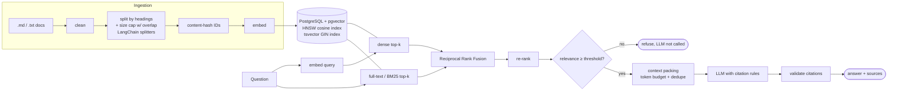

<h1 align="center">📚 Production RAG Pipeline</h1>

<p align="center">
  <b>Retrieval-Augmented Generation built like a production service, not a notebook.</b><br/>
  Idempotent ingestion · pgvector hybrid search (dense + full-text, RRF) · re-ranking · cited, grounded answers · safe refusal · an eval gate in CI.
</p>

<p align="center">
  <a href="https://github.com/wahyufaturrizky/production-rag-pipeline/actions/workflows/ci.yml"></a>
  
  
  
  
  
</p>

---

## Why this exists

Most RAG demos embed some text, take the top-3 chunks and hope for the best. In production that breaks in predictable ways:

| Failure mode | What this pipeline does |
|---|---|
| Exact terms (fees, product codes like **BI-FAST**, **KTA**) get lost by embeddings | **Hybrid retrieval**: dense vectors + BM25 / Postgres full-text, fused with **Reciprocal Rank Fusion** |
| The top chunk is related but doesn't answer the question | **Re-ranking** on query coverage and section titles before generation |
| The model answers anyway when the docs don't cover it | **Relevance threshold → refusal before the LLM is called**, plus honouring model refusals |
| Answers you can't verify | **Mandatory citations**, validated after generation; hallucinated `[n]` references are stripped and flagged |
| Re-running ingestion duplicates or leaves stale chunks | **Content-addressed chunk IDs** → idempotent upserts and stale-chunk deletion per document |
| "Did my chunking/prompt change make it worse?" | **Golden QA set + thresholds** → `rag eval` exits 1 and blocks the PR |

The demo corpus is the product documentation of **NusaBank, a fictional Indonesian digital bank** (cards, transfers, savings, disputes, security, loans).

## Architecture



## Quickstart (no API key, no database)

```bash
git clone https://github.com/wahyufaturrizky/production-rag-pipeline.git
cd production-rag-pipeline
python -m venv .venv && source .venv/bin/activate
pip install -e ".[dev]"

make test                                         # unit tests (pgvector tests skip without a DB)
make eval                                         # golden QA set + release gates
make ask Q="How much does a BI-FAST transfer cost?"
make run                                          # API on :8000, docs at /docs
```

```text
$ rag ask "How much does a BI-FAST transfer cost?"
BI-FAST transfers to other Indonesian banks cost IDR 2,500 per transaction and arrive in real time, 24/7. [1]
  [1] transfers.md > Transfers > BI-FAST interbank transfers

$ rag ask "What is NusaBank's current stock price?"
I don't have information about that in NusaBank's documentation. Please contact the 24/7 hotline 1500-321.
```

### With PostgreSQL + pgvector

```bash
make up    # docker compose: pgvector/pgvector:pg16 + the API (ingests on start)
curl -s localhost:8000/v1/ask -H 'content-type: application/json' \
  -d '{"question":"What is the RTGS fee?","debug":true}'
```

### With Gemini (free tier)

```bash
cp .env.example .env   # set GOOGLE_API_KEY, RAG_EMBEDDINGS=gemini, RAG_EMBED_DIM=768, RAG_LLM=gemini
rag eval               # re-run the gates with real embeddings + generation
```

Each embedding model gets its own table (`rag_chunks_hash`, `rag_chunks_gemini`), so switching models never mixes vector spaces.

## Evaluation

`eval/golden_qa.jsonl` has 18 answerable questions (with the expected document and section and key facts) and 4 unanswerable ones. `eval/thresholds.yaml` defines the release gates.

Current results with the **offline** stack (hash embeddings + extractive generator), on both the in-memory store and pgvector:

| Metric | Result | Gate |
|---|---|---|
| Hit rate @ 4 | 100% | ≥ 90% |
| MRR | 96% | ≥ 75% |
| Answer accuracy | 94.4% | ≥ 85% |
| Citation accuracy | 100% | ≥ 85% |
| Grounded rate | 100% | ≥ 95% |
| Refusal accuracy (unanswerable) | 100% | = 100% |

**Known failure, kept on purpose:** *"What is the age requirement to apply for a personal loan?"* is wrongly refused. The answer says *"aged 21 to 55"*, and lexical hash embeddings can't connect "age requirement" with "aged". This is the kind of gap semantic embeddings (`RAG_EMBEDDINGS=gemini`) close, and the eval report makes it visible instead of hiding it.

## API

| Method | Path | Purpose |
|---|---|---|
| `POST` | `/v1/ask` | `{"question": "...", "debug": false}` → answer, `refused`, `grounded`, citations, latency (and retrieval signals with `debug`) |
| `POST` | `/v1/ingest` | Re-ingest `RAG_DOCS_DIR`; returns inserted / unchanged / deleted per document |
| `GET` | `/healthz` | Chunk count and active embedding model and LLM |

## Project layout

```text
src/rag/
  ingest.py       # clean, heading-aware chunking (LangChain splitters), content-addressed IDs
  embeddings.py   # HashEmbeddings (offline) | GeminiEmbeddings (gemini-embedding-001, re-normalised)
  stores.py       # InMemoryStore (cosine + BM25) | PgVectorStore (HNSW + tsvector/GIN, idempotent upserts)
  retrieval.py    # hybrid retrieval, RRF, re-ranker, relevance threshold
  generation.py   # context packing, citation prompt, extractive | Gemini LLM, citation validation
  pipeline.py     # RAGPipeline: ingest_directory(), ask()
  evaluate.py     # retrieval + answer metrics, gates, reports
  cli.py, api.py  # `rag ingest | ask | eval` and FastAPI
data/docs/        # demo corpus (fictional bank)
eval/             # golden QA set + thresholds
```

## Design decisions

- **Hybrid by default.** Banking questions are full of exact tokens (amounts, product names). Dense vectors find paraphrases, full-text finds exact terms, and RRF merges them without score calibration.
- **Refuse early.** If nothing relevant is retrieved, the pipeline refuses without calling the LLM, which is cheaper and leaves nothing to hallucinate.
- **Citations are checked, not trusted.** Out-of-range citations are removed, and answers with uncited sentences are flagged `grounded: false`.
- **Offline-first CI.** Deterministic embeddings and an extractive generator make the eval gate reproducible and free. The same gate runs against Gemini when a key is present.

## Roadmap

- [ ] Cross-encoder / LLM re-ranker behind the same interface
- [ ] PDF and HTML loaders with table-aware chunking
- [ ] Query rewriting for multi-turn follow-up questions
- [ ] Ragas-style faithfulness scoring with an LLM judge (see [llm-eval-reliability](https://github.com/wahyufaturrizky/llm-eval-reliability))

## License

MIT © [Wahyu Fatur Rizky](https://github.com/wahyufaturrizky)
